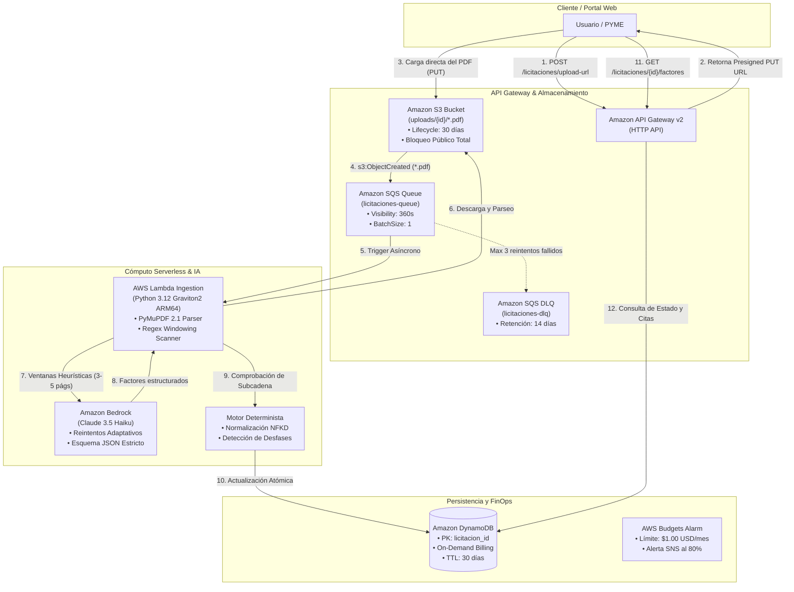
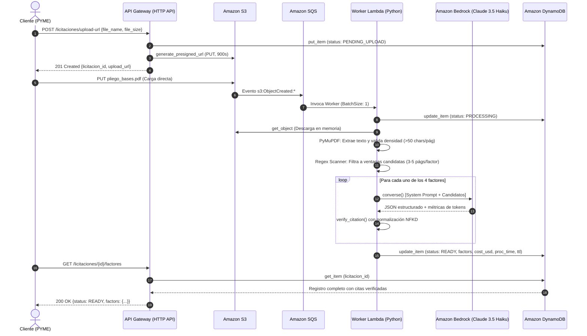

# 🇨🇱 Mercado Público RAG AWS: Pipeline Serverless de Auditoría de Riesgo Contractual

[](https://aws.amazon.com/)
[](https://www.python.org/)
[](https://aws.amazon.com/serverless/sam/)
[](https://aws.amazon.com/bedrock/)
[](#-arquitectura-finops-y-control-de-costos-free-tier)
[-brightgreen.svg)](#-suite-de-pruebas-automatizadas)
[](https://github.com/astral-sh/ruff)

> Pipeline cloud-native event-driven y serverless en AWS diseñado para extraer, auditar y verificar de forma determinista los **4 factores de riesgo financiero y legal crítico** en pliegos de contratación pública chilena ([Mercado Público](https://www.mercadopublico.cl) - Ley N° 19.886), operando con costo fijo $0 USD bajo el AWS Free Tier.

---

## 📌 Contexto de Negocio y Problema

En las compras públicas en Chile reguladas por la **Ley N° 19.886 de Bases sobre Contratos Administrativos de Suministro y Prestación de Servicios**, los pliegos y bases de licitación son documentos PDF no estructurados de entre **30 y 180 páginas**. 

Para una Pequeña o Mediana Empresa (PYME) o proveedor tecnológico, postular a una licitación sin un análisis legal y financiero riguroso representa un riesgo existencial:
- **Pérdida de Garantías:** La no entrega o entrega defectuosa de la boleta de seriedad de la oferta o fiel cumplimiento (habitualmente 5% a 10% del contrato) acarrea la ejecución forzosa de los fondos.
- **Sanciones y Multas Fatales:** Multas diarias acumulativas por atraso que pueden alcanzar topes del 10% al 20% del valor total antes de la rescisión unilateral del contrato.
- **Descalificación Inmediata:** Desconocimiento de umbrales técnicos mínimos eliminatorios en los criterios de evaluación.
- **Plazos y Cómputo Erróneo:** Confusión entre *días hábiles administrativos* (Ley N° 19.880, excluye sábados, domingos y festivos) y *días corridos*.

Este proyecto implementa una solución de **Inteligencia Artificial Generativa y Auditoría Determinista** que analiza pliegos completos en menos de 45 segundos, identificando y verificando matemáticamente las cláusulas contractuales clave.

---

## 🎯 Los 4 Factores Críticos Auditados

| Factor de Riesgo | Definición y Alcance de Auditoría | Riesgo Contractual Mitigado |
| :--- | :--- | :--- |
| **1. Garantías** | Tipo (seriedad / fiel cumplimiento), monto explícito (UF, CLP, %), plazo de vigencia y texto exacto de la glosa obligatoria. | Cobro involuntario de pólizas y descalificación formal de la oferta. |
| **2. Criterios de Evaluación** | Ponderación técnica (%), ponderación económica (%), y puntaje técnico mínimo descalificatorio. | Inversión de recursos en licitaciones técnicamente inviables. |
| **3. Régimen de Multas** | Causales de penalización, monto diario de sanción (UF/día) y tope máximo porcentual. | Insolvencia financiera por penalizaciones desmedidas ante retrasos. |
| **4. Plazos Fatales** | Fecha y hora exacta de cierre en el portal, tipo de cómputo (días hábiles vs corridos) y plazo de entrega. | Presentación de ofertas fuera de plazo fatal o incumplimiento de cronograma. |

---

## 🏗️ Arquitectura del Sistema

El pipeline adopta un patrón **Event-Driven Serverless** desacoplado, asíncrono y resiliente a límites de concurrencia:



---

## 🔄 Diagrama de Secuencia E2E



---

## 💡 Decisiones de Arquitectura e Ingeniería (ADR)

### 1. Ventana Heurística Directa vs Base Vectorial Local en Lambda
* **Problema:** En prototipos iniciales se evaluó incrustar bases vectoriales en memoria (como LanceDB o ChromaDB). Sin embargo, las dependencias compiladas de Apache Arrow (`pyarrow`) y LanceDB superan los **200 MB** en arquitecturas Linux ARM64, poniendo en riesgo el límite estricto de **250 MB descompromidos** de las capas de AWS Lambda.
* **Solución Adoptada:** Se reemplazó el almacenamiento vectorial por un **escáner heurístico de expresiones regulares compiladas** en [`src/common/constants.py`](file:///D:/Proyectos/mercado-publico-rag-aws/src/common/constants.py). El escáner filtra un pliego de 100 páginas a ventanas de 3 a 5 páginas candidatas por factor ($\sim 2.000$ tokens).
* **Impacto:** Empaquetado ligero (< 45 MB con PyMuPDF), eliminación del 100% de los costos de embeddings en Amazon Titan y reducción de latencia a < 45 segundos.

### 2. Resiliencia contra Throttling en Amazon Bedrock (HTTP 429)
* **Problema:** Cuentas con cuotas iniciales en Bedrock pueden experimentar `ThrottlingException` ante llamadas concurrentes hacia Claude 3.5 Haiku.
* **Solución Adoptada:** Cliente Boto3 configurado con política de reintentos exponencial y modo adaptativo:
  ```python
  botocore.config.Config(retries={"max_attempts": 5, "mode": "adaptive"})
  ```
  Complementado con procesamiento unitario en SQS (`BatchSize: 1` y `MaximumConcurrency: 2`).

### 3. Motor Antialucinación Determinista con Normalización Unicode NFKD
* **Problema:** Los LLMs pueden parafrasear inadvertidamente fragmentos o verse afectados por ligaduras tipográficas en PDFs (`fi`, `fl`, comillas curvas `“”` o guiones largos `—`), provocando falsos positivos en verificadores de subcadena directos.
* **Solución Adoptada:** Implementación de [`normalize_text`](file:///D:/Proyectos/mercado-publico-rag-aws/src/ingestion/verifier.py#L5-L42), que descompone caracteres diacríticos con `unicodedata.normalize('NFKD', text)`, suprime marcas combinadas, unifica comillas a ASCII estándar y comprueba subcadenas. Si la cita no está en la página indicada pero se encuentra en la anterior o posterior, emite una advertencia de salto de página y etiqueta el factor como `REQUIRES_MANUAL_REVIEW`.

### 4. Modelo de Datos Fuertemente Tipado (Regla de Cero Decisiones)
* Arquitectura basada en **Pydantic v2** y `pydantic-settings` ([`src/common/models.py`](file:///D:/Proyectos/mercado-publico-rag-aws/src/common/models.py)), garantizando contratos inmutables para `GarantiaFactor`, `CriterioFactor`, `MultaFactor`, `PlazoFactor` y `TenderExtractionResult`.

---

## 💰 Arquitectura FinOps y Control de Costos (Free Tier)

El sistema fue diseñado desde la primera línea de código para tener un costo base de **$0.00 USD/mes**:

| Servicio AWS | Asignación Free Tier Mensual | Consumo Estimado del Pipeline | Costo Fijo |
| :--- | :--- | :--- | :--- |
| **Amazon S3** | 5 GB almacenamiento estándar, 20.000 GETs, 2.000 PUTs | < 500 MB (limpieza automática con Lifecycle a 30 días) | **$0.00 USD** |
| **AWS Lambda** | 1.000.000 invocaciones y 3.200.000 segundos-GB | ~500 invocaciones/mes (~50.000 segundos-GB) | **$0.00 USD** |
| **Amazon SQS** | 1.000.000 solicitudes | < 2.000 mensajes/mes | **$0.00 USD** |
| **Amazon DynamoDB**| 25 GB almacenamiento y 25 WCU / 25 RCU (Modo On-Demand) | < 50 MB, lecturas y escrituras puntuales | **$0.00 USD** |
| **Amazon Bedrock** | Facturación por tokens (Claude 3.5 Haiku) | ~$0.0008 / 1K tokens in \| ~$0.004 / 1K tokens out | **~$0.0035 USD / pliego** |

> 🛡️ **Seguro FinOps Incorporado:** La plantilla de infraestructura [`template.yaml`](file:///D:/Proyectos/mercado-publico-rag-aws/template.yaml) provisiona automáticamente un recurso `AWS::Budgets::Budget` configurado con un límite mensual estricto de **$1.00 USD** y notificación vía SNS al superar el 80% de consumo.

---

## 🔌 Especificación de la API REST

### 1. Solicitar URL de Carga Prefirmada
Genera una URL segura y temporal de Amazon S3 para que el cliente cargue su PDF directamente sin sobrecargar el backend.

```bash
curl -X POST https://{api-id}.execute-api.us-east-1.amazonaws.com/licitaciones/upload-url \
  -H "Content-Type: application/json" \
  -d '{
    "file_name": "bases_administrativas_licitacion_2026.pdf",
    "file_size_bytes": 2048576
  }'
```

**Respuesta Exitosa (`201 Created`):**
```json
{
  "licitacion_id": "LIC-A1B2C3D4E5",
  "upload_url": "https://licitaciones-uploads-xxx.s3.amazonaws.com/uploads/LIC-A1B2C3D4E5/bases_administrativas_licitacion_2026.pdf?AWSAccessKeyId=...",
  "s3_key": "uploads/LIC-A1B2C3D4E5/bases_administrativas_licitacion_2026.pdf",
  "expires_in_seconds": 900
}
```

---

### 2. Consultar Estado de Procesamiento
Permite consultar el progreso de ingesta y las métricas acumuladas de latencia y costo.

```bash
curl -X GET https://{api-id}.execute-api.us-east-1.amazonaws.com/licitaciones/LIC-A1B2C3D4E5/status
```

**Respuesta Exitosa (`200 OK`):**
```json
{
  "licitacion_id": "LIC-A1B2C3D4E5",
  "status": "READY",
  "total_pages": 42,
  "cost_usd_estimate": 0.00384,
  "processing_time_ms": 14250,
  "uploaded_documents": ["bases_administrativas_licitacion_2026.pdf"],
  "error_message": null,
  "created_at": "2026-11-11T12:00:00Z",
  "updated_at": "2026-11-11T12:00:14Z"
}
```

---

### 3. Consultar Factores Contractuales Auditados
Retorna el desglose de los 4 factores con su trazabilidad de citas verificadas sobre el texto original.

```bash
curl -X GET https://{api-id}.execute-api.us-east-1.amazonaws.com/licitaciones/LIC-A1B2C3D4E5/factores
```

**Respuesta Exitosa (`200 OK`):**
```json
{
  "licitacion_id": "LIC-A1B2C3D4E5",
  "status": "READY",
  "total_pages": 42,
  "cost_usd_estimate": 0.00384,
  "processing_time_ms": 14250,
  "uploaded_documents": ["bases_administrativas_licitacion_2026.pdf"],
  "factors": {
    "garantias": {
      "identificado": true,
      "tipo_garantia": "Fiel y oportuno cumplimiento",
      "monto": "5% del valor total adjudicado",
      "vigencia": "90 días corridos contados desde la firma del contrato",
      "glosa": "Para garantizar el fiel y oportuno cumplimiento del contrato",
      "pagina_citada": 8,
      "fragmento_exacto": "garantía de fiel y oportuno cumplimiento equivalente al 5% del valor total",
      "verificado_en_pagina": true,
      "status": "VERIFIED",
      "source_file": "bases_administrativas_licitacion_2026.pdf",
      "advertencia": null
    },
    "criterios": {
      "identificado": true,
      "ponderacion_tecnica": "70%",
      "ponderacion_economica": "30%",
      "puntaje_minimo_descalificatorio": "60 puntos",
      "pagina_citada": 14,
      "fragmento_exacto": "ponderación técnica del 70% y ponderación económica del 30%",
      "verificado_en_pagina": true,
      "status": "VERIFIED",
      "source_file": "bases_administrativas_licitacion_2026.pdf",
      "advertencia": null
    },
    "multas": {
      "identificado": true,
      "causal_principal": "Atraso en la entrega de hitos del cronograma",
      "monto_diario": "2 UF por cada día hábil de retraso",
      "tope_maximo": "10% del monto total del contrato",
      "pagina_citada": 22,
      "fragmento_exacto": "multa diaria de 2 UF por cada día hábil de atraso con tope máximo del 10%",
      "verificado_en_pagina": true,
      "status": "VERIFIED",
      "source_file": "bases_administrativas_licitacion_2026.pdf",
      "advertencia": null
    },
    "plazos": {
      "identificado": true,
      "cierre_ofertas": "30 de noviembre de 2026 a las 15:00 horas",
      "tipo_computo": "Días hábiles administrativos (Ley N° 19.880)",
      "plazo_entrega": "45 días corridos",
      "pagina_citada": 4,
      "fragmento_exacto": "cierre de recepción de ofertas será el 30 de noviembre de 2026 a las 15:00 horas",
      "verificado_en_pagina": true,
      "status": "VERIFIED",
      "source_file": "bases_administrativas_licitacion_2026.pdf",
      "advertencia": null
    }
  }
}
```

---

## 📂 Estructura del Repositorio

```text
mercado-publico-rag-aws/
├── docs/
│   └── designs/
│       ├── pipeline-serverless-rag-mercado-publico.md  # Documento de Diseño Técnico (EGM)
│       └── SITEMAP.md                                   # Índice de especificaciones
├── src/
│   ├── api/
│   │   ├── __init__.py
│   │   └── handler.py             # Lambda API Gateway (Presigned URLs, Status, Factores)
│   ├── common/
│   │   ├── __init__.py
│   │   ├── config.py              # Configuración tipada pydantic-settings
│   │   ├── constants.py           # Patrones Regex Mercado Público y Prompts
│   │   └── models.py              # Esquemas de datos Pydantic v2 fuertemente tipados
│   └── ingestion/
│       ├── __init__.py
│       ├── candidate_selector.py  # Escáner heurístico de páginas candidatas
│       ├── extractor.py           # Cliente Amazon Bedrock Claude 3.5 Haiku
│       ├── handler.py             # Lambda Worker SQS/S3 y actualización atómica DynamoDB
│       ├── parser.py              # Extractor PDF PyMuPDF y detector de escaneos
│       └── verifier.py            # Verificador determinista de citas Unicode NFKD
├── tests/
│   ├── integration/
│   │   ├── __init__.py
│   │   └── test_pipeline_e2e.py   # Simulación End-to-End del ciclo de vida completo
│   └── unit/
│       ├── __init__.py
│       ├── test_api.py            # Pruebas de endpoints y contratos HTTP
│       ├── test_foundations.py    # Pruebas de configuración, regex y modelos
│       ├── test_ingestion.py      # Pruebas de ingesta asíncrona y mocks AWS
│       ├── test_parser.py         # Pruebas de PyMuPDF y detección de PDFs vacíos
│       └── test_verifier.py       # Pruebas de normalización Unicode y antialucinación
├── scripts/
│   └── validate_template.py       # Script utilitario de validación sintáctica IaC
├── template.yaml                  # Infraestructura como Código (AWS SAM / CloudFormation)
├── samconfig.toml                 # Configuración de despliegue SAM CLI
├── requirements.txt               # Dependencias de producción para AWS Lambda
├── requirements-dev.txt           # Dependencias de desarrollo, linting y pruebas
└── README.md                      # Documentación ejecutiva del proyecto
```

---

## 🧪 Suite de Pruebas Automatizadas

El proyecto cuenta con **27 pruebas automatizadas** que cubren la totalidad de los componentes unitarios e integraciones:

```bash
# Ejecutar la suite completa de pruebas con pytest
python -m pytest tests/ -v
```

**Salida de Ejecución:**
```text
tests/integration/test_pipeline_e2e.py::test_pipeline_e2e_full_lifecycle PASSED  [  3%]
tests/unit/test_api.py::test_post_upload_url_success PASSED                       [  7%]
tests/unit/test_api.py::test_post_upload_url_invalid_extension PASSED             [ 11%]
tests/unit/test_api.py::test_post_upload_url_invalid_size PASSED                  [ 14%]
tests/unit/test_api.py::test_get_status_found PASSED                              [ 18%]
tests/unit/test_api.py::test_get_status_not_found PASSED                          [ 22%]
tests/unit/test_api.py::test_get_factores_ready PASSED                            [ 25%]
tests/unit/test_api.py::test_cors_preflight PASSED                                [ 29%]
tests/unit/test_foundations.py::test_settings_defaults PASSED                     [ 33%]
tests/unit/test_foundations.py::test_section_patterns_matching PASSED             [ 37%]
tests/unit/test_foundations.py::test_page_content_validation PASSED               [ 40%]
tests/unit/test_foundations.py::test_factor_models_and_inheritance PASSED          [ 44%]
tests/unit/test_foundations.py::test_tender_extraction_result PASSED              [ 48%]
tests/unit/test_foundations.py::test_upload_url_request_validation PASSED          [ 51%]
tests/unit/test_ingestion.py::test_select_candidate_pages_matching_and_fallback PASSED [ 55%]
tests/unit/test_ingestion.py::test_parse_sqs_s3_event_canonical_key PASSED       [ 59%]
tests/unit/test_ingestion.py::test_bedrock_extractor_clean_json_parsing PASSED    [ 62%]
tests/unit/test_ingestion.py::test_lambda_handler_full_pipeline_success PASSED    [ 66%]
tests/unit/test_ingestion.py::test_lambda_handler_scanned_pdf_failure PASSED     [ 70%]
tests/unit/test_parser.py::test_extract_pages_valid_pdf PASSED                    [ 74%]
tests/unit/test_parser.py::test_extract_pages_scanned_pdf_raises_exception PASSED [ 77%]
tests/unit/test_parser.py::test_extract_pages_invalid_bytes_raises_exception PASSED [ 81%]
tests/unit/test_verifier.py::test_normalize_text_unicode_ligatures_and_quotes PASSED [ 85%]
tests/unit/test_verifier.py::test_verify_citation_exact_match PASSED              [ 88%]
tests/unit/test_verifier.py::test_verify_citation_adjacent_page_detection PASSED  [ 92%]
tests/unit/test_verifier.py::test_verify_citation_hallucinated_text PASSED       [ 96%]
tests/unit/test_verifier.py::test_verify_citation_page_out_of_bounds PASSED      [100%]

============================= 27 passed in 1.09s =============================
```

```bash
# Verificación estricta de estilo y calidad de código con Ruff
python -m ruff check src/ tests/
# Salida: All checks passed!
```

---

## 🚀 Despliegue en AWS con SAM CLI

### Prerrequisitos
1. Cuenta de AWS con credenciales configuradas en `~/.aws/credentials` (permisos para IAM, S3, SQS, DynamoDB, Lambda, API Gateway y Bedrock).
2. [AWS SAM CLI instalado](https://docs.aws.amazon.com/serverless-application-model/latest/developerguide/install-sam-cli.html).
3. Python 3.12 instalado.
4. Modelo Claude 3.5 Haiku habilitado en la consola de **Amazon Bedrock** (Región `us-east-1`).

### Comandos de Despliegue

```bash
# 1. Validar la plantilla CloudFormation / SAM
cfn-lint template.yaml
sam validate

# 2. Compilar artefactos con optimización ARM64
sam build

# 3. Desplegar en la nube (la primera vez usa el modo guiado)
sam deploy --guided
```

---

## 👤 Autor

**Víctor Neira**  
*Estudiante de Ingeniería en Informática — AIEP (Chile)*  
*AWS Certified Cloud Practitioner (AWS re/Start Graduate)*  
- **GitHub:** [@VitoNez5198](https://github.com/VitoNez5198)
- **Áreas de Interés:** Arquitectura Cloud Serverless, FinOps, Soluciones Event-Driven con IA Generativa.

---

## 📄 Licencia

Este proyecto se distribuye bajo la licencia **MIT**. Consulte el archivo `LICENSE` para mayores detalles.

